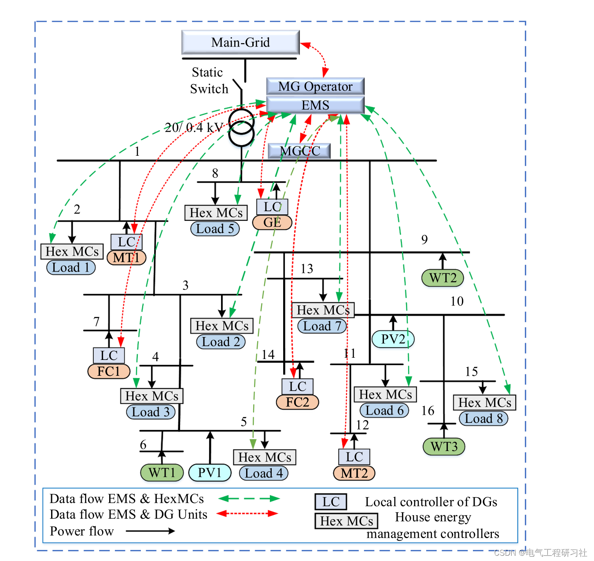
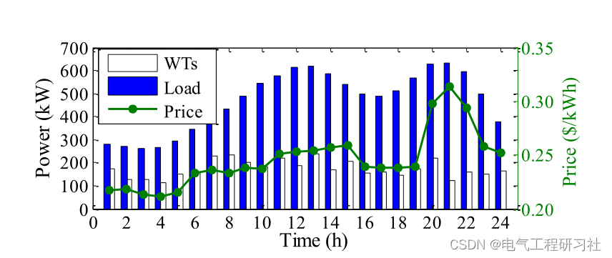
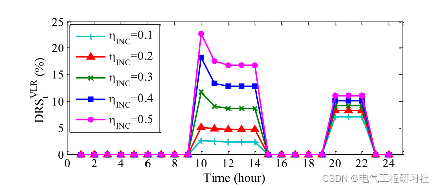
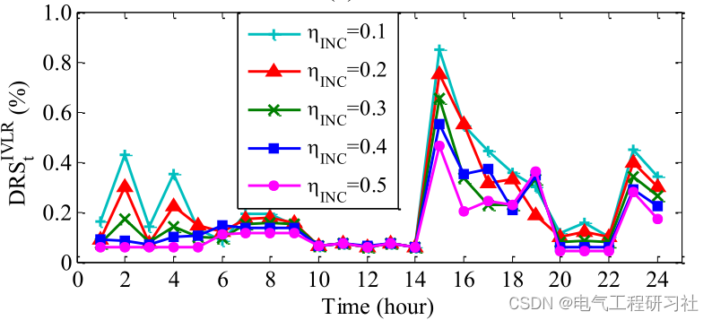
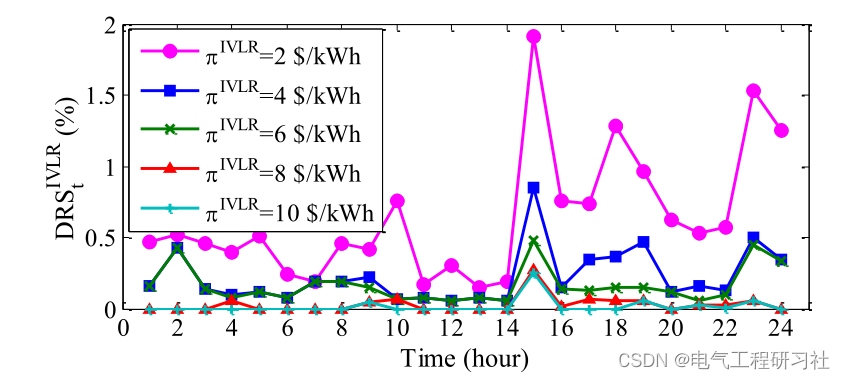
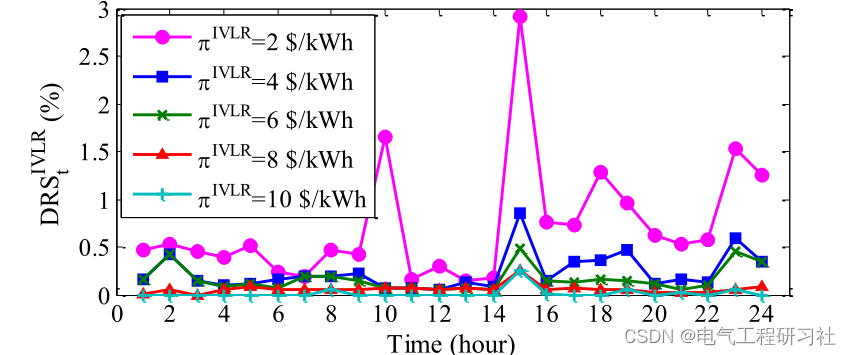
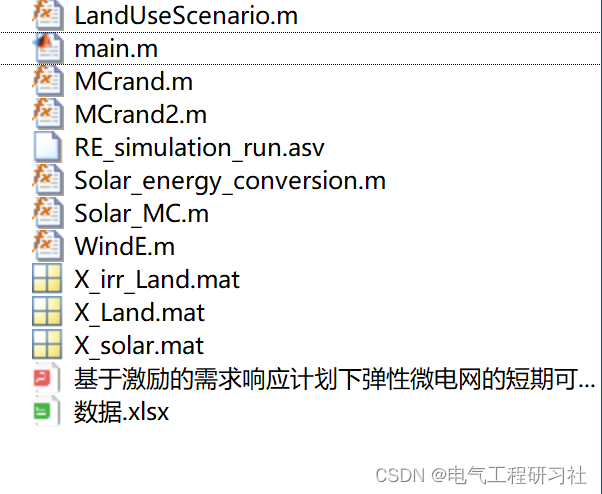

# Short-term reliability and economic evaluation of flexible microgrids under incentive-based demand response plans (Matlab code implementation)

Abstract: This paper proposes a flexible random scheduling framework for evaluating the short-term reliability and economics of islanded microgrids (MGs) under different incentive-based demand response (IBDR) plans. Considering multi-period island constraints, it prepares MGs to respond elastically to disturbances in the main grid. Additionally, the optimal power flow (OPF) method is employed to model the actions of IBDR and the provision of backup resources. Furthermore, uncertainties related to electricity prices, load, renewable energy generation, backup demand, and the duration of MG island operations are taken into account. The ultimate goal of MG operators is to maximize their expected profits while minimizing the cost of customer energy procurement under certain levels of safety and reliability. Based on equipment characteristics, customer and operator behaviors, and considering normal operation and elastic conditions, the economic and reliability indicators of MGs are studied. This model can effectively manage the operation of MGs under normal and elastic conditions to improve economic and reliability metrics. Numerical results show that by implementing IBDR, the expected profit of MG operators increases by 4% and 2.7% under normal and elastic operation conditions, respectively, with reliability metrics improving by 60% and 56%, respectively.
In [17], a flexible random framework for MG scheduling was proposed to minimize operational costs and reduce forced load shedding due to weather-related events. In the aforementioned study, the reliability issues were not considered during island events. Moreover, the impact of uncertainties (such as island events and disaster recovery participants) on system reliability was not addressed.
Editor
3. Mathematical Model 3.1 Uncertainty Representation and Modeling Procedures This study considers two main types of uncertainty. The first category is known as normal operational uncertainty, which includes uncertainties related to load forecasting errors, electricity prices, renewable energy generation, and reserve demand. The hourly random variable value is equal to the predicted value plus a random error generated based on the distribution obtained from historical data [20]. First, the prediction error of a category of uncertainty is modeled using the normal probability distribution function (PDF), and then Monte Carlo simulation (MCS) [20] is applied to generate many scenarios based on random sampling from the relevant PDF. (See Section 5 for a detailed mathematical model).
3.2. IBDR project model response load participation in the IBDR program is modeled based on incentives and penalties imposed on customers. When customer j participates in the IBDR program, their hourly demand changes from an initial value to a revised value as shown below:
3.3 Implement a short-term reliability assessment procedure to evaluate the short-term operational reliability of MG, the expected demand index (EDNSt) for unserved time t, and the energy reliability index (EIRt), as defined below:
3.4 Objective Function (OF) Considering the conditional Value at Risk (CVaR) under different risk aversion levels, the objective is to maximize the expected profit of MG operators (EP), as shown below:
For details, refer to Part 5.
3.5 The optimization problem proposed by network and market constraints is subject to the following constraints: 1) Power balance constraint: Equations (26) and (27) respectively provide the power balance limits for node n at time t and scenario s.
Editor
4.2 Results and discussion This section analyzes the impact of implementing the IBDR program on normal and resilient MG based on economic and reliability indicators.
Editor
Editor
Editor
5. Matlab code and detailed explanation of the article. This article only showcases a part of the code, all codes can be found in:
Editor
6 Conclusions A flexible MGs scheduling stochastic model is proposed to simultaneously address the impact of IBDR plans on economic and reliability metrics. Uncertainties related to load, renewable energy, electricity prices, backup demand, and the duration of MG island are addressed by CVaR tools. The study investigates the uncertainty behavior of users under normal operation and elastic conditions for different reliability metrics.
7 End Notes

## Images

<!-- PAYMENT_BLOCK -->

## Get this dataset

- Payment link (Stripe): [Buy now](https://buy.stripe.com/3cs8yP7sY87d0vu9AB)
- Payment QR code: 

<!-- /PAYMENT_BLOCK -->
